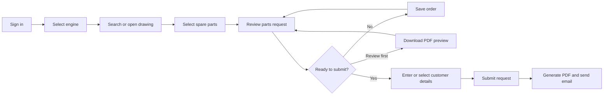

# ⚙️ Daikai Interactive Spare Parts Library

## 🚢 Application introduction

The Daikai Interactive Spare Parts Library is an internal web application that helps users identify engine spare parts, prepare accurate parts requests, and send complete order information to the Daikai sales team.

Instead of searching manually through large spare-parts books, users can open an engine drawing, select the required part directly from the drawing, review the part information, and add it to a request. The application then creates a professional PDF document containing the customer, vessel, engine, drawing, and selected-parts information.

## 🎯 Business purpose

The application is designed to improve the spare-parts request process by:

- Reducing the time needed to find parts in technical manuals.
- Reducing errors in part codes, drawing references, and quantities.
- Standardizing the information received by the sales team.
- Keeping vessel and engine information connected to each customer account.
- Producing a consistent PDF request that can be reviewed, downloaded, and emailed.
- Allowing unfinished orders to be saved and continued later.

## 🔄 Typical user workflow

## ✨ Main features

### 🧩 Interactive engine drawings

Users can browse spare-parts drawings by Chapter, Main Item, and Item & Drawing Name. Part-number hotspots on the technical drawing connect each drawing callout to its parts code, name, and standard quantity.

The drawing viewer includes zoom controls and supports part selection directly from the image.

### 🔎 Parts catalogue search

Users can search using:

- Part name
- Parts code
- Drawing number
- Chapter and item information

Selecting a search result opens the correct drawing and highlights the relevant part.

### 📚 Reference manuals

Users can download the spare-parts reference manual for the selected engine. Each engine can use a different PDF manual, allowing the library to expand as additional engine models become available.

### 🛒 Parts request cart

Selected parts are collected in one request cart. Users can:

- Review all selected parts.
- Change requested quantities.
- Remove unwanted items.
- Return to the original drawing.
- Continue browsing and add more parts.

### 💾 Saved orders

If a user is not ready to submit, the current order can be saved. Saved orders are associated with the signed-in user and can be restored during a later session.

After a request is submitted successfully, its saved draft is removed automatically.

### 👤 Customer, vessel, and engine profiles

Each user account can store:

- Contact name
- Email address
- Company
- Phone number
- Multiple vessels
- A unique IMO number for each vessel
- Multiple engines for each vessel
- A unique serial number for each engine

On the Customer Details page, saved information can be selected from editable dropdown lists. Users can also enter different information manually when required.

Selecting a saved vessel automatically fills its IMO number. Selecting an engine belonging to that vessel automatically fills its engine serial number.

### 📄 PDF preview and final request

Before submitting, users can download a PDF preview for internal or customer review. Creating a preview does not submit the request or send an email.

After submission, the system:

1. Validates the customer and selected-parts information.
2. Creates the official request record.
3. Generates a branded Daikai PDF.
4. Sends confirmation emails when SMTP is configured.
5. Allows the official PDF to be downloaded.
6. Clears the submitted cart and saved draft.

The generated PDF includes the Daikai logo and company header, customer and engine information, requested parts, drawing references, quantities, and page numbers.

## 🔐 User roles

### 👷 User

A standard user can:

- Select available engines.
- Browse and search drawings.
- Select parts and prepare a request.
- Save an unfinished order.
- Use saved customer, vessel, and engine information.
- Download reference manuals.
- Download a PDF preview.
- Submit a request and download the final PDF.
- Change their own password.

### 🛡️ Administrator

An administrator has all standard user functions and can also:

- Create user accounts.
- Assign User or Administrator roles.
- Register customer, vessel, and engine profiles.
- Activate or deactivate accounts.
- Reset user passwords.
- Delete eligible user accounts.
- Manage email recipients for submitted orders.
- Display, add, move, remove, and save drawing hotspots.

## 📈 Benefits for managers

| Area | Benefit |
|---|---|
| Request accuracy | Part codes, drawing references, and quantities come from controlled drawing data. |
| Processing speed | Users locate parts visually and submit complete information in one workflow. |
| Data consistency | Every request follows the same structure and PDF format. |
| Customer service | Saved vessel and engine profiles reduce repeated data entry. |
| Traceability | Submitted requests are saved with a request ID, timestamp, JSON record, and PDF. |
| Work continuity | Users can save unfinished orders and continue later. |
| Administration | Account access, roles, profiles, and recipients are managed from one page. |
| Expansion | Additional engines, drawings, parts data, and manuals can be added over time. |

## 🚦 Current engine availability

The home page displays engine models based on images stored in the engine catalogue.

Current status:

| Engine | Status |
|---|---|
| 6DE18 | Available |
| 6DE20 | Coming soon |
| DE33 | Coming soon |

The 6DE20 and DE33 options remain visible to show planned coverage but cannot be selected until their drawings and parts data are ready.

## 🗂️ Information storage

The current application stores operational data in JSON files within the backend data directory:

- User accounts, roles, and profiles
- Saved order drafts
- Drawing metadata
- Hotspot positions
- Parts information
- Submitted request records

Generated request PDFs are stored with their associated request records.

Passwords are not stored as plain text. They are salted and hashed before being written to the account settings file.

## 🏗️ Application architecture

The application has two main components:

- A React frontend that provides the user interface.
- A FastAPI backend that manages authentication, drawings, parts, profiles, saved orders, PDF generation, and email delivery.

The data structure is file-based and suitable for the current internal workflow. It can later be migrated to a database if the number of users, requests, or concurrent operations increases.

## 📌 Current deployment notes

- The application is currently intended for internal use.
- Email delivery requires valid SMTP configuration.
- Restarting the backend currently invalidates active login sessions, so users must sign in again.
- Only 6DE18 has an active drawing library at this stage.
- Additional engine datasets and manuals can be activated when their content is ready.

## 🎬 Suggested demonstration

For a short user or management presentation:

1. Sign in with a standard user account.
2. Select the available 6DE18 engine.
3. Search for a part or select one from a drawing.
4. Add the part to the request cart.
5. Change the quantity and save the order.
6. Open Customer Details and select a saved vessel and engine.
7. Download the PDF preview.
8. Submit the request.
9. Show the success notification and download the official PDF.
10. Sign in as an administrator and briefly show user/profile management and hotspot editing.

## 🚀 Future development opportunities

- Add complete drawing libraries for 6DE20 and DE33.
- Add more engine models and reference manuals.
- Persist login sessions across backend restarts.
- Add an administrator interface for editing existing customer profiles.
- Introduce request history, search, status tracking, and reporting.
- Move operational data to a managed database when required.
- Add production authentication, authorization auditing, backup, and deployment controls.
